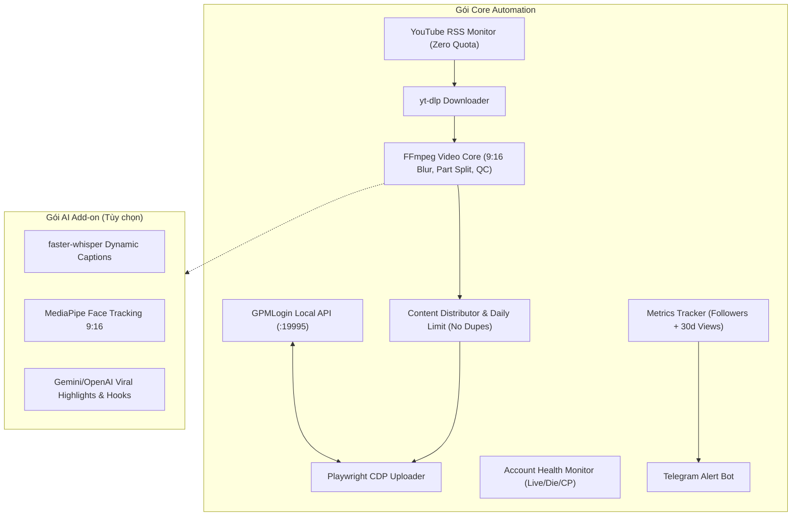

# Kế hoạch triển khai: TikTok Auto Farm Tool (bản điều chỉnh)
**Ngày cập nhật:** 22 Oct 2026 · @nguyen

---

## 1. Tổng quan và phạm vi
Phần mềm Windows chạy local, tự động hóa chuỗi: tìm và theo dõi kênh YouTube, tải video mới, cắt và chỉnh sửa, đăng lên TikTok qua GPMLogin, theo dõi follower và báo về Telegram khi tài khoản đạt 10.000 follower.

Dự án chia thành hai gói để khách chọn theo ngân sách:
- **Gói Core:** Đăng TikTok qua GPMLogin, theo dõi kênh YouTube và tải video, cắt và chỉnh sửa cơ bản bằng FFmpeg, phân phối nội dung theo tài khoản, tracking và cảnh báo Telegram, dashboard.
- **Gói AI Add-on (tùy chọn):** Cắt đoạn hay bằng AI, phụ đề động, tự động căn khung 9:16 theo khuôn mặt, AI viết hook và tiêu đề.

Tiêu đề và hashtag mặc định lấy từ video YouTube gốc, đúng như yêu cầu ban đầu. AI viết lại tiêu đề là một tùy chọn bật hoặc tắt.

---

## 2. Giả định và điều kiện
Báo giá và thời gian dưới đây dựa trên các điều kiện sau. Điều kiện nào thay đổi thì phạm vi hoặc giá được trao đổi lại.

| Hạng mục | Quy ước |
| :--- | :--- |
| **Tài khoản TikTok, proxy, profile GPMLogin** | Khách tự chuẩn bị. Mỗi profile có proxy và fingerprint riêng. |
| **Phí proxy, captcha (2Captcha/CapSolver), AI API (Gemini/OpenAI)** | Khách tự chi trả theo mức sử dụng. |
| **Cấu hình máy tối thiểu** | Windows 10/11, RAM 16 GB, SSD. Gói AI Add-on nên có card NVIDIA để render nhanh. |
| **Số profile chạy đồng thời** | Mặc định 2-3. Tối đa tùy cấu hình máy, được kiểm chứng khi test. |
| **Điều kiện beta/Creator Rewards** | Khách xác nhận chương trình cụ thể. Ngưỡng cảnh báo (follower, lượt xem 30 ngày) cấu hình được, mặc định 10.000 follower. |
| **Bản quyền nội dung nguồn** | Khách chịu trách nhiệm về quyền sử dụng video nguồn (xem mục 11). |
| **Mã nguồn** | Bàn giao bản cài .exe. Mã nguồn bàn giao thêm nếu hai bên thỏa thuận riêng. |

---

## 3. Kiến trúc tổng thể
Phân hệ đăng TikTok (Phân hệ 1) được làm trước vì rủi ro cao nhất.  
**Công nghệ:** Python 3.11+ (FastAPI), PyWebView, Playwright, FFmpeg, yt-dlp, SQLite.  
Gói AI Add-on thêm faster-whisper, nhận diện khuôn mặt và gọi API Gemini hoặc OpenAI.



---

## 4. Phân hệ 1: Đăng TikTok qua GPMLogin (Làm đầu tiên - Spike Test)
Đây là phần rủi ro cao nhất nên được làm trước, dưới dạng bản thử nghiệm 4-5 ngày trên 5-10 profile thật của khách. Nếu bước này không đạt thì các phân hệ còn lại chưa cần triển khai.

### Kết nối GPMLogin (Local API 127.0.0.1:19995)
- Đồng bộ danh sách profile, mở và đóng profile theo hàng đợi, giới hạn số profile mở cùng lúc.
- Dùng nguyên proxy và fingerprint đã cài trên từng profile.

### Đăng video bằng Playwright (CDP)
- Gắn vào cổng debug của Chrome do GPM cấp, mở trang upload của TikTok Studio.
- Tải video lên, điền tiêu đề và hashtag, chọn ảnh bìa, đăng ngay hoặc hẹn giờ.
- Mỗi bước có kiểm tra trạng thái và chụp ảnh màn hình khi lỗi để dễ chẩn đoán.

### Giới hạn và hành vi an toàn
- Giới hạn số video mỗi tài khoản mỗi ngày, giờ đăng ngẫu nhiên trong khung giờ cấu hình.
- Thao tác có độ trễ ngẫu nhiên (gõ phím, di chuột). Đây là cách giảm rủi ro, không bảo đảm tránh được việc TikTok phát hiện.
- Tích hợp dịch vụ giải captcha (2Captcha/CapSolver) khi có captcha. Phí do khách chi trả.

### Phát hiện tình trạng tài khoản
- Nhận biết các trạng thái: chưa đăng nhập, bị checkpoint hoặc captcha, upload lỗi, nghi bị hạn chế.
- Tự tạm dừng tài khoản có vấn đề, ghi log và báo lên dashboard thay vì cố đăng lại liên tục.
- Cơ chế thử lại: tối đa 2-3 lần cho mỗi video, sau đó chuyển sang trạng thái "lỗi" để khách xem.
- *Lưu ý bảo trì:* Giao diện trang upload của TikTok thay đổi thường xuyên, nên selector sẽ cần cập nhật định kỳ (xem mục 12).

---

## 5. Phân hệ 2: YouTube Intelligence
### Lọc kênh theo từ khóa
- Nhập từ khóa ngách, nhận về 50-100 kênh còn hoạt động, kèm số subscriber, tổng số video, lượt xem trung bình.
- Tần suất đăng: tính từ 10 video gần nhất (số ngày trung bình giữa hai video, ngày đăng gần nhất). Có bộ lọc loại kênh ngừng hoạt động (ví dụ không có video mới trong 30 ngày).
- Dùng YouTube Data API v3 với API key của khách. Tìm kiếm tốn nhiều quota nên kết quả được lưu đệm. Chi tiết kênh dùng các lệnh quota thấp.

### Theo dõi kênh và tải video
- Mỗi kênh lưu sẵn được kiểm tra định kỳ (10-30 phút) qua **RSS feed chính thức của YouTube (`/feeds/videos.xml?channel_id=...`)**, không tốn quota API.
- Phát hiện video mới và Shorts mới, tự tải bằng `yt-dlp` vào hàng đợi.
- Xử lý trường hợp kênh bị xóa hoặc chuyển riêng tư: đánh dấu kênh "không khả dụng" và tiếp tục chạy.
- Tải nhiều video từ một IP có thể bị YouTube chặn, nên hỗ trợ cookie và proxy cho bước tải. `yt-dlp` được cập nhật khi YouTube thay đổi.

---

## 6. Phân hệ 3: Xử lý video
Phân hệ này có hai mức. Gói Core cho kết quả ổn định, nhẹ máy. Gói AI Add-on nâng chất lượng clip nhưng nặng hơn về tài nguyên và chi phí API.

### Gói Core (FFmpeg)
- Cắt video dài thành các phần theo độ dài cấu hình (mặc định 60-90 giây), cắt tại ranh giới câu hoặc khoảng lặng thay vì cắt cứng theo thời gian.
- Chuyển sang khung dọc 9:16 theo ba kiểu: cắt giữa, nền mờ (video đặt giữa trên bản mờ của chính nó), hoặc giữ nguyên khung.
- Thêm tùy chọn chỉnh sửa: chèn thanh tiến trình, số phần (Part 1, 2, 3), logo hoặc chữ chèn.
- **Dùng tiêu đề và hashtag YouTube gốc làm mặc định.** Có tùy chọn AI viết lại tiêu đề.
- Mã hóa bằng NVENC nếu máy có card NVIDIA, ngược lại dùng CPU.
- **Kiểm tra chất lượng (Quality Check) trước khi đăng:** độ dài, có âm thanh, kích thước file, tỉ lệ khung. Clip không đạt bị loại, không đưa vào hàng đợi đăng.

### Gói AI Add-on (Tùy chọn)

| Tính năng | Cách làm | Giới hạn cần biết |
| :--- | :--- | :--- |
| **Cắt đoạn hay** | Nhận dạng giọng nói để có transcript, AI (Gemini Flash/OpenAI) chấm điểm các đoạn theo mở đầu mạnh, ý trọn vẹn, có kết. Kết hợp thêm tín hiệu âm lượng và đổi cảnh. Cắt tại ranh giới câu. | Chất lượng phụ thuộc nội dung nguồn. Tốn phí API theo mức dùng. |
| **Phụ đề động** | faster-whisper nhận dạng giọng nói, xuất file phụ đề ASS, hiệu ứng từng từ và tô màu từ khóa, render bằng FFmpeg. | Độ chính xác giảm với video nhiều tiếng, giọng vùng miền, hoặc nhiều ngôn ngữ trộn lẫn. Mốc thời gian từng từ rất gần đúng nhưng không tuyệt đối. |
| **Căn khung theo khuôn mặt** | Nhận diện khuôn mặt, làm mượt chuyển động khung hình, đặt lại khi đổi cảnh. | Chỉ hiệu quả với video người nói. Nhiều người nói cùng lúc thì theo khuôn mặt chính. Video game, màn hình, slide tự chuyển sang kiểu nền mờ. |
| **AI viết hook và tiêu đề** | Tạo câu hook 3 giây đầu, tiêu đề, bộ hashtag theo ngách do khách khai báo. | AI không biết hashtag nào đang thịnh hành. Khách có thể nhập danh sách hashtag riêng cho từng ngách. |

- **Chế độ duyệt (tùy chọn):** Clip do AI tạo ra có thể đi qua hàng đợi duyệt thủ công, hoặc lấy mẫu ngẫu nhiên để khách kiểm tra, tránh clip lỗi đăng đồng loạt lên hàng trăm tài khoản.
- **Nội dung gốc và biến thể:** Mỗi video nguồn có thể tạo nhiều clip với đoạn cắt, tiêu đề khác nhau cho các tài khoản khác nhau. Phần mềm không cam kết video qua được hệ thống phát hiện trùng lặp của TikTok.

---

## 7. Phân hệ 4: Quản lý tài khoản, tracking và cảnh báo

### Phân phối nội dung theo tài khoản (Distributor)
- Gán kênh nguồn cho nhóm tài khoản (ví dụ kênh A cấp video cho nhóm 1, kênh B cho nhóm 2).
- Mỗi clip chỉ đăng một lần cho mỗi tài khoản, tránh nhiều tài khoản cùng đăng một clip giống hệt.
- Cấu hình theo từng tài khoản: số video tối đa mỗi ngày, khung giờ đăng, trạng thái bật hoặc tắt.
- Tùy chọn giai đoạn làm nóng (Warm-up) tài khoản mới: số video ít và tăng dần trong những ngày đầu.

### Theo dõi chỉ số
- Mỗi ngày quét follower và lượt xem của từng tài khoản, lưu vào SQLite.
- Dashboard hiển thị tài khoản tăng trưởng tốt nhất, tài khoản đang lỗi, hàng đợi video, log.

### Cảnh báo Telegram
- Khi tài khoản đạt ngưỡng (mặc định 10.000 follower, kèm điều kiện lượt xem 30 ngày nếu khách bật), bot gửi tin nhắn gồm tên kênh, số follower, lượt xem 30 ngày, profile GPM.
- Cảnh báo thêm khi tài khoản gặp lỗi liên tục hoặc nghi bị hạn chế.
- Ngưỡng cấu hình được vì điều kiện của chương trình beta có thể gồm nhiều tiêu chí hơn số follower.

---

## 8. Cấu trúc mã nguồn

```
tiktok-farm/
├── backend/
│   ├── app.py                  # FastAPI, khởi động ứng dụng
│   ├── config.py               # cấu hình: GPM, Telegram, API key, ngưỡng cảnh báo
│   ├── database.py             # SQLite: kênh, video, clip, tài khoản, log
│   ├── scheduler.py            # lập lịch, hàng đợi công việc
│   └── modules/
│       ├── gpm_client.py       # GPMLogin Local API
│       ├── tiktok_uploader.py  # Playwright CDP, đăng video
│       ├── account_health.py   # phát hiện lỗi, tạm dừng tài khoản
│       ├── yt_scanner.py       # tìm kênh, tính tần suất đăng
│       ├── yt_monitor.py       # RSS, phát hiện video mới
│       ├── yt_downloader.py    # yt-dlp
│       ├── distributor.py      # gán nguồn cho tài khoản, giới hạn mỗi ngày
│       ├── video_core/         # GÓI CORE: cắt, 9:16, kiểm tra chất lượng
│       ├── ai_addon/           # GÓI AI: highlight, phụ đề, face tracking, copywriter
│       ├── metrics_tracker.py  # quét follower, lượt xem
│       └── notifier.py         # Telegram
├── frontend/                   # giao diện dashboard (HTML/CSS/JS gọn, dùng PyWebView)
├── data/                       # downloads, clips, logs, db
├── requirements.txt
├── main.py
└── build_exe.bat               # đóng gói .exe (bản AI Add-on có dung lượng lớn)
```

---

## 9. Báo giá và tiến độ thanh toán

| Gói | Nội dung | Thời gian | Chi phí (VNĐ) |
| :--- | :--- | :--- | :--- |
| **Core** | Đăng TikTok qua GPMLogin, YouTube Intelligence, xử lý video bằng FFmpeg, phân phối nội dung, tracking, cảnh báo Telegram, dashboard, kiểm thử, đóng gói .exe | 4 - 5 tuần | **50.000.000 - 65.000.000** |
| **AI Add-on** | Cắt đoạn hay, phụ đề động, căn khung theo khuôn mặt, AI viết hook và tiêu đề, chế độ duyệt | +2 - 3 tuần | **25.000.000 - 40.000.000** |
| **Trọn gói** | Core và AI Add-on kết hợp | 6 - 8 tuần | **75.000.000 - 105.000.000** |

*Chi phí vận hành do khách chi trả:* proxy, dịch vụ captcha, AI API, bản quyền GPMLogin, máy chủ hoặc máy tính chạy phần mềm.

### Tiến độ thanh toán
1. **Đợt 1 (40%):** Ký hợp đồng, bắt đầu bản thử nghiệm đăng TikTok qua GPMLogin.
2. **Đợt 2 (30%):** Sau demo chạy được toàn bộ chuỗi trên một số profile thật: phát hiện video mới, xử lý, đăng lên TikTok.
3. **Đợt 3 (30%):** Bàn giao bản hoàn chỉnh đạt tiêu chí nghiệm thu (mục 11).

*Nếu mua gói AI Add-on sau, thanh toán 50% khi bắt đầu và 50% khi nghiệm thu.*

---

## 10. Rủi ro và trách nhiệm

| Rủi ro | Mô tả | Cách giảm thiểu |
| :--- | :--- | :--- |
| **Bản quyền** | Đăng lại video của người khác có thể bị gỡ nội dung, khiếu nại hoặc khóa tài khoản | Ưu tiên nguồn có giấy phép hoặc được phép sử dụng lại. Khách chịu trách nhiệm về nguồn nội dung. |
| **Chính sách TikTok về nội dung không gốc** | Nội dung đăng lại có thể bị giảm phân phối hoặc không đủ điều kiện nhận thu nhập từ chương trình của TikTok | Thêm giá trị thật cho clip (bình luận, lồng tiếng, biên tập). Kiểm tra điều kiện chương trình beta trước khi nuôi số lượng lớn. |
| **Phát hiện nhiều tài khoản** | Hàng trăm tài khoản có thể bị khóa hàng loạt nếu hành vi giống nhau | Proxy và fingerprint riêng cho từng profile, giờ đăng ngẫu nhiên, giới hạn số video mỗi ngày, nội dung khác nhau giữa các tài khoản. |
| **Thay đổi giao diện TikTok** | Selector hỏng, việc đăng lỗi | Có log và ảnh chụp lỗi, gói bảo trì (mục 11). |
| **YouTube chặn tải** | Tải nhiều video từ một IP có thể bị chặn | Hỗ trợ cookie, proxy, cập nhật yt-dlp. |
| **Dung lượng và cảnh báo của Windows** | Gói AI Add-on có thể nặng vài GB và bị Windows Defender báo nhầm | Cung cấp bản cài đặt có hướng dẫn, ký số nếu khách có chứng chỉ. |
| **Hiệu năng máy** | Render, nhận dạng giọng nói và nhiều profile cùng chạy sẽ tranh tài nguyên | Giới hạn số tác vụ song song, đo thực tế khi test. |

*Tuyên bố trách nhiệm:* Khách chịu trách nhiệm về việc tuân thủ điều khoản của YouTube và TikTok, quyền sử dụng nội dung nguồn, và hậu quả đối với tài khoản. Bên thực hiện không chịu trách nhiệm về việc tài khoản bị khóa, nội dung bị gỡ hoặc không được duyệt vào chương trình beta.

---

## 11. Nghiệm thu, bảo hành và bảo trì

### Tiêu chí nghiệm thu (Gói Core)
- Đăng thành công tối thiểu **95% trên 50 lần đăng thử**, chạy trên 10 profile thật của khách.
- Phát hiện video mới từ kênh theo dõi trong vòng **30 phút** và tự đưa vào hàng đợi.
- Mỗi video tải về được cắt thành các phần đúng độ dài cấu hình và qua bước kiểm tra chất lượng.
- Cảnh báo Telegram gửi đúng khi tài khoản thử đạt ngưỡng cấu hình.
- Phần mềm chạy liên tục **48 giờ** không phải khởi động lại thủ công.

### Tiêu chí bổ sung (Gói AI Add-on)
- Phụ đề khớp lời nói trên bộ video mẫu hai bên thống nhất.
- Căn khung theo khuôn mặt giữ được người nói trong khung với video dạng người nói trực diện.
- Clip AI cắt luôn bắt đầu và kết thúc ở ranh giới câu.

### Bảo hành & Bảo trì
- **Bảo hành:** 30 ngày kể từ ngày nghiệm thu, sửa lỗi phần mềm thuộc phạm vi đã nghiệm thu.
- **Bảo trì (tùy chọn):** Gói hàng tháng gồm cập nhật khi TikTok hoặc YouTube thay đổi giao diện hoặc cách tải, cập nhật yt-dlp, và hỗ trợ kỹ thuật. Đề xuất 10-20% chi phí phát triển mỗi tháng, hoặc gói cố định do hai bên thỏa thuận.
